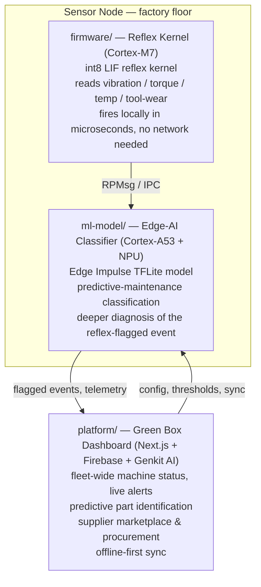

# Green Box — Edge-AI Predictive Maintenance for Industrial Equipment

Green Box turns any factory machine into a self-monitoring asset: a low-cost
sensor node watches vibration, torque, temperature, and tool-wear in real
time, catches early failure signatures on-device, and hands that insight to
a fleet dashboard that closes the loop — from "this bearing is about to
fail" to "the replacement part is on order from a verified local supplier."

Built for environments with many mid-size manufacturing lines and
unreliable connectivity — which is exactly the profile of a large share of
Egyptian industrial SMEs — Green Box is designed to keep working even when
the factory floor's internet does not.

## Why this matters for Egyptian manufacturing

- **Unplanned downtime is expensive and common.** Predictive maintenance
  catches degrading bearings, motors, and tooling days before failure,
  instead of after a line stops.
- **Connectivity on the factory floor is not guaranteed.** The reflex layer
  runs entirely on-device, so safety-critical detection never depends on a
  network link, and the platform is built for offline-first sync.
- **Spare parts sourcing is fragmented.** The marketplace layer connects a
  detected fault directly to verified local suppliers, cutting the time
  between "we found a problem" and "we fixed it."
- **Hardware cost matters.** The architecture is deliberately split so the
  expensive AI computation happens once per fleet (cloud/dashboard) while
  each sensor node stays cheap, using a microcontroller-class reflex layer
  rather than requiring AI hardware at every single sensor point.

## System architecture

Green Box is one product built in three tiers. This repository merges all
three, previously developed as separate repos, into a single project.



| Tier | Folder | Role | Runs on |
|---|---|---|---|
| **Reflex** | [`firmware/`](firmware/) | Millisecond-scale local anomaly detection — a lightweight int8 LIF (leaky integrate-and-fire) reflex kernel that trips on abnormal sensor patterns without needing the network or the AI layer | Cortex-M7 (real-time core) |
| **Cognition** | [`ml-model/`](ml-model/) | Heavier on-device classification — an Edge Impulse-trained TFLite model that turns a reflex-flagged event into a specific predictive-maintenance classification | Cortex-A53 + NPU (Linux, NXP eIQ) |
| **Platform** | [`platform/`](platform/) | Fleet dashboard, live alerts, AI-assisted diagnosis chat, predictive part identification, and a B2B spare-parts marketplace with supplier recommendation | Web (Next.js), Firebase, Genkit AI |

The two device-side tiers talk to each other over RPMsg on the SoC (e.g. an
NXP i.MX 8M Plus, which pairs an M7 real-time core with an A53 + NPU
application core on one chip). The platform tier talks to the fleet over
the cloud and is built offline-first, since factory connectivity can be
patchy.

## Current state of each tier

This merge is honest about what's implemented versus scaffolded — useful to
know before a pilot conversation:

- **`platform/`** — Functional Next.js app: dashboard, live alerts, node
  list, marketplace, supplier pages, and four Genkit AI flows
  (conversational maintenance chat, problem diagnosis, predictive part
  identification, supplier recommendation), wired to Firebase.
- **`ml-model/`** — A trained and exported Edge Impulse model (`.tflite` +
  C++ inferencing library) for predictive-maintenance classification,
  trained on the AI4I 2020 predictive maintenance dataset. **Important:**
  the original exported model had a data-leakage bug (used post-failure
  diagnostic flags as inputs, giving a fake near-perfect accuracy that
  collapsed to 0% recall under real deployment conditions). A corrected,
  honestly-evaluated version lives in
  [`ml-model/v2-no-leakage/`](ml-model/v2-no-leakage/) (94% recall / 29%
  precision on a real held-out test set) — see that folder's README for
  the full methodology and a tunable precision/recall threshold table.
- **`firmware/`** — The reflex kernel's core math and IPC interface are
  real and desktop-tested (see [`firmware/README.md`](firmware/README.md)
  for exactly what's tested vs. stubbed). The FreeRTOS/ADC/RPMsg-hardware
  glue is scaffolded and waiting on final sensor-board hardware.

## Repository layout

```
greenbox-unified/
├── firmware/       Reflex kernel — Cortex-M7 real-time sensing (C)
├── ml-model/       Edge Impulse TFLite predictive-maintenance model (C++)
├── platform/       Fleet dashboard & B2B marketplace (Next.js/TypeScript)
├── docs/           Product blueprint, architecture notes, data schema
└── LICENSE         MIT
```

## Getting each tier running

**Platform (dashboard/marketplace):**
```bash
cd platform
npm install
npm run dev
```

**Reflex kernel desktop test (no hardware needed):**
```bash
cd firmware
gcc -std=c11 -Wall -Wextra -Iinclude src/reflex_kernel.c \
    src/ipc_rpmsg_stub.c test/desktop_reflex_test.c -lm -o reflex_test
./reflex_test
```

**ML model:** see [`ml-model/README.txt`](ml-model/README.txt) for how to
deploy the Edge Impulse C++ library on target hardware.

## Roadmap (from here to a pilot)

1. Finalize the sensor board and ADC channel mapping for `firmware/`.
2. Wire real RPMsg-Lite and FreeRTOS into the reflex kernel; benchmark on
   real M7 silicon.
3. Run a Phase 2 field pilot to calibrate reflex thresholds and retrain the
   classifier on real factory data (current data/thresholds are
   placeholders, documented as such in `firmware/README.md`).
4. Connect the on-device tiers to `platform/`'s live-alerts and node
   pages end-to-end.

## License

MIT — see [`LICENSE`](LICENSE).
